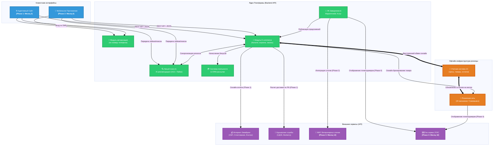

# zoo_market

## Концепция проекта: Омниканальная PetTech-экосистема федерального уровня

## 1. Общие сведения, активы и инвестиции

- Наименование проекта: Экосистема зоотоваров и сервисов.
- Ключевой инвестор и эксперт: Мария Собачкина (профильный опыт в зоо-маркетплейсах).
- Инвестиционный бюджет: 15 000 000 рублей на горизонт 2 года (24 месяца).
- Текущие активы бизнеса:
    
    - Действующая розничная сеть из 20 магазинов (Дальневосточный регион).
    - Учетная система 1С (база данных товаров, остатков и цен).
    - Валидированная клиентская база — 1 500 активных профилей.
    
- Бизнес-цель: Оцифровка существующей розницы, запуск онлайн-продаж по модели Phased Rollout и подготовка инфраструктуры для экспансии в Центральную Россию через 2 года.

---

## 2. Платформенная стратегия и ИТ-ландшафт

Вместо дорогостоящей одновременной разработки всех платформ утверждается гипотезоориентированный подход (Lean Approach):

1. Старт с Web-версии (Сайт): Разработка адаптивного web-сайта. Он выступает в роли пилота (MVP) для обкатки интеграций с 1С, эквайрингом, логистикой и проверки спроса.
2. Мобильное приложение (iOS/Android): Разрабатывается как отдельный этап (Phase 2–3) только после подтверждения коммерческой эффективности сайта и стабилизации процессов.
3. Идентификация пользователей: Сквозная авторизация на всех этапах (в онлайне и на кассах в магазинах) строго по номеру телефона (через SMS-код или Flash Call) для бесшовного клиентского опыта.

---

## 3. Стратегическая дорожная карта и этапы запуска (Roadmap)
[M0] Старт (Сайт, 1С, 20 магазинов)

  │
  
  ├──► [M3] Phase 1: Омниканальный E-commerce (Сайт, 1С, Логистика, Бронь, Онлайн-оплата, Поиск, UGC/Лайки, Лояльность)
  
  │
  
  ├──► [M6] Phase 2: Marketplace & CSR (Заводчики, донаты, Мобильное приложение, Рекомендательный AI-движок)
  
  │
  
  ├──► [M12] Phase 3: MedTech Aggregator (Онлайн-запись в ветеринарные клиники)
 
  │
  
  ├──► [M18] Phase 4: Pet Care Services & Hyperlocal (Услуги, интеграция с 2ГИС, Безопасная сделка)
  
  │
  
  └──► [M24+] Масштабирование: Экспансия в Центральную Россию

## Phase 1: Запуск торговой веб-платформы (Готовность: 3 месяца)

- Функциональный контур: Продажа еды и атрибутики через адаптивный сайт.
- Интеллектуальный поиск товаров: Интеграция умного поискового движка с поддержкой автозаполнения, исправления опечаток, поиска по синонимам (например, «поводок» ➔ «шлейка») и учетом морфологии русского языка. Результаты поиска должны мгновенно сопоставляться с остатками в выбранном пользователем магазине.
- Социальный контур и UGC (Пользовательский контент): Базовый модуль вовлечения. Возможность добавлять товары в «Избранное» (лайки товаров), ставить оценки (рейтинг по 5-звездочной шкале) и оставлять текстовые отзывы с премодерацией в админ-панели.
- Финтех-модуль (Онлайн-оплата): Интеграция интернет-эквайринга (карты, СБП, Яндекс Пэй). Двусторонняя интеграция платежного шлюза с 1С для автоматической фискализации (54-ФЗ) и изменения статусов заказов.
- Интеграция с 1С: Двусторонний обмен данными в реальном времени (остатки в каждом из 20 магазинов, актуальные цены, выгрузка оплаченных заказов).
- Гео-ритейл и логистика: Выбор розничного магазина для самовывоза с онлайн-бронированием. Для регионов без физического присутствия сети — интеграция со СДЭК/Boxberry с обязательной онлайн-предоплатой.
- Система лояльности и CRM: Единая бонусная/дисконтная система (онлайн + офлайн). Модуль рассылок для отправки сервисных уведомлений (подтверждение оплаты, готовность брони) и маркетинговых новостей. Авторизация по номеру телефона.

## Phase 2: Запуск маркетплейса, КСО и рекомендательного AI-движка (Готовность: 6 месяцев)

- Функциональный контур: Подключение верифицированных заводчиков, запуск донатов для приютов со сплитованием платежей.
- Автоматизированная рекомендательная система: Внедрение алгоритмов персонализации на основе собранных на Phase 1 данных (лайки, оценки, история покупок, глубина просмотра категорий). Реализация блоков:
    
    - _«С этим товаром также покупают»_ (Cross-sell в карточке товара и корзине: например, к ошейнику рекомендуются шлейки и поводки).
    - _«Похожие товары»_ (Upsell: альтернативные корма того же класса).
    - _«Вы недавно смотрели»_ и персональные подборки на главной странице сайта на основе интересов конкретного питомца (кошка/собака/птица).
    
- Развитие платформ: При успехе веб-версии — разработка мобильного приложения со встроенной функцией оплаты в один клик и персональной лентой рекомендаций.

## Phase 3: Сервисная MedTech-экосистема (Готовность: 12 месяцев)

- Функциональный контур: Интеграция с МИС ветеринарных клиник-партнеров по API для онлайн-записи. Оценки и отзывы пользователей расширяются на карточки ветеринарных врачей.

## Phase 4: Бытовые услуги и гиперлокальный поиск (Готовность: 18 месяцев)

- Функциональный контур: Запуск маркетплейса услуг (груминг, передержка, выгул). Интеграция с картами 2ГИС для поиска исполнителей. Внедрение функционала «Безопасной сделки» (Escrow-счета). Рекомендательная система начинает предлагать локальные услуги (например, если клиент часто покупает товары для выставочных собак, система рекомендует топ-грумеров поблизости).

## Горизонт 2 года (24+ месяца): Федеральная экспансия

- Выход на рынок Центральной России с готовой, интеллектуально персонализированной ИТ-платформой и распределенными фулфилмент-центрами.

---

## 4. Оптимизация бюджета (15 млн рублей на 2 года)

- Этапность внедрения AI: Чтобы не тратить весь ИТ-бюджет на старте, на Phase 1 (3 месяца) рекомендации настраиваются вручную контент-менеджером в админке (статические связи товаров). Полноценный рекомендательный движок на базе алгоритмов внедряется только на Phase 2, когда накопится массив лайков, оценок и транзакций от стартовой базы в 1500+ клиентов.
- Фокус затрат: Основной финансовый фокус первых 3 месяцев — бесшовная связка: «Поиск ➔ Сайт ➔ 1С ➔ Онлайн-оплата».
## 5. Диаграмы

### 🌐 Архитектурная схема омниканальной PetTech-экосистемы

